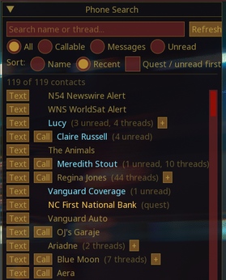

# Phone Search

Search every phone contact and message thread from a Cyber Engine Tweaks window, then open the thread or place the call, for Cyberpunk 2077. Single-player only.
Version 1.0.1 | For game version 2.5 | Status: 1.0.1 not run in game yet; 1.0.0 was used in game (a problem seen there led to 1.0.1), with no written test result

> This is an unofficial fan work and is not approved/endorsed by CD PROJEKT RED. No game files are included.



The screenshot was taken with the installed build, which also loads an optional colour file. The published `init.lua` does not load it, so the window uses CET's default colours.

## The problem

With many contacts, including the ones that phone mods add, finding one person in the phone means a lot of scrolling. Read message threads are hidden on the phone's default tab, so an old conversation is even harder to reach.

## What I built

A CET window that lists every contact and message thread with a search box. Text opens the vanilla phone straight on that thread, read threads too; Call places the same call the phone's dialer starts. It changes: nothing in the save; for the one opening it asks for, the phone shows all threads and, if needed, one extra thread row. 422 lines of Lua and a 287-line redscript helper.

## How it works

- `Snapshot()` in the redscript system lists what the vanilla phone lists: the Contacts tab (`MessengerUtils.GetCallableAndNonEmptyContacts`) and every message thread, read ones too (`GetSimpleContactDataArray`). Mods that add phone contacts through the Holo framework hook those same functions, so their contacts show up as well.
- Type a few letters and press Enter, or click Text or Call. Several words must all match. Enter acts on the top result: Text if it has messages, otherwise Call. "+" lists one contact's threads so a single thread can be opened.
- The action waits until the overlay closes and runs 0.35 seconds later, so the phone gets the keyboard and mouse. Cancel drops it.
- Text opens the phone the way a message notification does: it sets the phone's message-to-open hash and sends the game's own "use phone" request. "Show all" is switched on for that one opening and back off when the contact list closes.
- Call checks that the contact can be called and that calling is allowed right now, then queues the same call request as the dialer's Call button. If the phone is blocked (combat, a scene, a call running), the window shows a warning and nothing opens.
- Four `@wrapMethod` hooks, no replaced methods: the phone controller's `OnInitialize` and `OnUninitialize` (to keep a reference to it), `OnContactListClosed` (to switch "Show all" back) and `MessengerUtils.GetSimpleContactDataArray` (to add one thread row, see the engineering notes). All four targets match the 2.5 game scripts.

```text
package/
  bin/x64/plugins/cyber_engine_tweaks/mods/CyberslopPhoneSearch/init.lua   the window
  r6/scripts/CyberslopPhoneSearch/CyberslopPhoneSearch.reds                reads and opens threads and contacts
tests/mock.lua    runs the Lua against a stubbed game API (39 checks)
```

Run the test from an empty folder, because it writes the mod's settings file into the current folder: `luajit <repo>/tests/mock.lua <repo>/package/bin/x64/plugins/cyber_engine_tweaks/mods/<mod folder>/init.lua`.

## Requirements

| Requirement | Version | Link |
|---|---|---|
| Cyberpunk 2077 | 2.5 | |
| Cyber Engine Tweaks | a build for 2.5 | [Nexus Mods, mod 107](https://www.nexusmods.com/cyberpunk2077/mods/107) |
| redscript | a build for 2.5 | [Nexus Mods, mod 1511](https://www.nexusmods.com/cyberpunk2077/mods/1511) |

No other mod is needed. Requirements are not bundled.

## Install

1. Install the requirements above.
2. Copy the contents of `package/` into the game folder, so that `r6\scripts\CyberslopPhoneSearch\CyberslopPhoneSearch.reds` exists.
3. Start the game, load a save and open the CET overlay. The "Phone Search" window shows with the cursor in the search box. If the redscript part is missing or did not compile, the window says so.

## Uninstall / roll back

1. Close the game.
2. Delete `bin\x64\plugins\cyber_engine_tweaks\mods\CyberslopPhoneSearch\` (this also removes its `settings.json`) and `r6\scripts\CyberslopPhoneSearch\`.
3. Saves are not affected. The mod keeps no data in the save.

## Configuration

In the window, saved in `settings.json` next to `init.lua`:

| Option | Default | Choices |
|---|---|---|
| Filter | All | All, Callable, Messages, Unread |
| Sort | Name | Name, Recent |
| Quest / unread first | on | |

Hotkey in CET's Bindings tab, unbound by default: "Show / hide window". The window shows only while the CET overlay is open.

## Status

| Version | Game | Result |
|---|---|---|
| 1.0.0 | 2.5 | Compiles (0 errors; the warnings are the same as without the mod). Used in game: a read contact from a Holo-based mod was listed without Text or Call buttons, which led to 1.0.1. No written test result. |
| 1.0.1 | 2.5 | Compiles (0 errors). Not run in game. |
| Mock test | | 39 of 39 checks pass with LuaJIT on the published `init.lua` (unchanged since 1.0.0). It covers search, multi-word search, Enter, the queue on overlay close, thread pick, Call, Cancel, the blocked-phone warning, an unknown result, filters, sort, settings, and no player, no redscript system or a failing snapshot. It runs in CI. |

## Compatibility

| Item | Status | Notes |
|---|---|---|
| Holo-based contact mods | listed | Holo contacts are text only, the same as in the phone. Read, unpinned Holo contacts get a thread row since 1.0.1. |
| Other mods that wrap the phone's contact list | checked against their code, not played together | When it was built, no other installed mod wrapped `OnContactListClosed`; mods that wrap the phone's list population pass the selection hash through. |

## Known issues

- The header comment of `init.lua` says 1.0.0; the window did not change in 1.0.1, only the redscript file did.
- Senders without a Contacts-tab entry are listed as "(unknown)" when the phone has no name for them.

## Engineering notes

**Symptom.** Typing `yuk` listed the contact Yukmouth (added by a drug dealer mod built on the Holo framework) with "[Enter]" next to it, but with no Text or Call button, and Enter did nothing.

**Diagnosis.** Holo puts a contact into the phone's message list only while it is unread or pinned. A read, unpinned Holo contact is on the Contacts tab only, and Holo contacts cannot be called. Version 1.0.0 took threads from the message list alone, so that row had no thread and no call, and Enter had nothing to act on. Even with the right hash, the phone would have dropped it: the game zeroes a message-to-open hash that is not in the message list.

**Fix (1.0.1, redscript only).** `Snapshot()` adds a thread row for every Contacts-tab contact that has messages but no row in the message list. `OpenThread()` remembers that hash, and a new wrap of `MessengerUtils.GetSimpleContactDataArray` adds that contact's thread to the message list for that one opening, so the phone can select it. The hash is dropped when the contact list closes.

**Check.** The redscript compiles with 0 errors against the full installed script set. The in-game check (type `yuk`, Enter, close the overlay: the phone opens on that thread with replies selectable) has not been done yet.

**Rollback.** 1.0.1 was installed with a backup of the 1.0.0 file. For a user: delete two folders.

## Changelog

See [CHANGELOG.md](CHANGELOG.md). Latest: 1.0.1 (2026-11-23): read Holo contacts that are only on the Contacts tab get Text too.

## Credits and licence

Runs on Cyber Engine Tweaks and redscript, which are not included here. Works with contacts added through the Holo phone framework by NightlyNow.

MIT, see [LICENSE](LICENSE). The licence covers my code only. Game names and trademarks belong to their owners.

Built with AI assistance (Claude); designed, tested and maintained by me.
